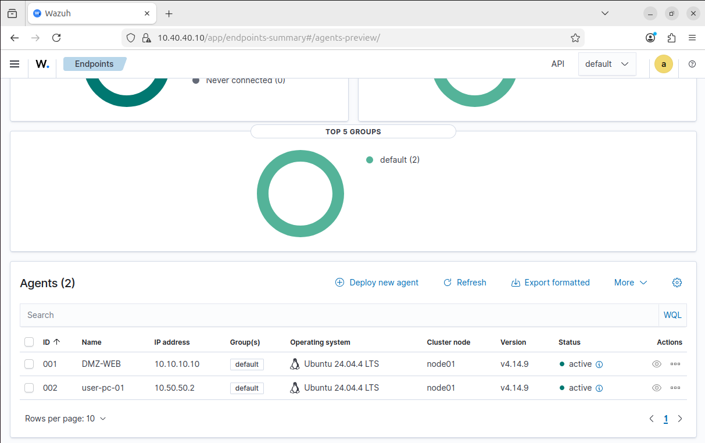
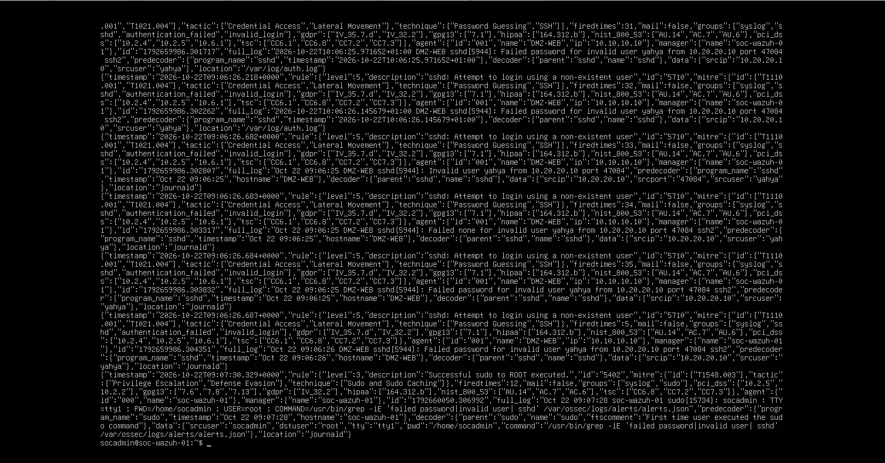
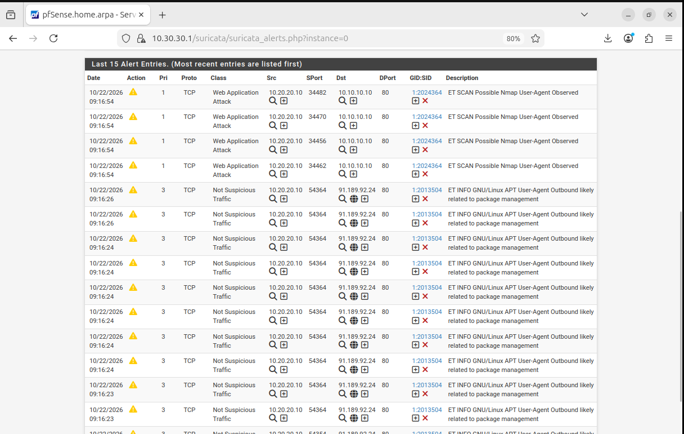
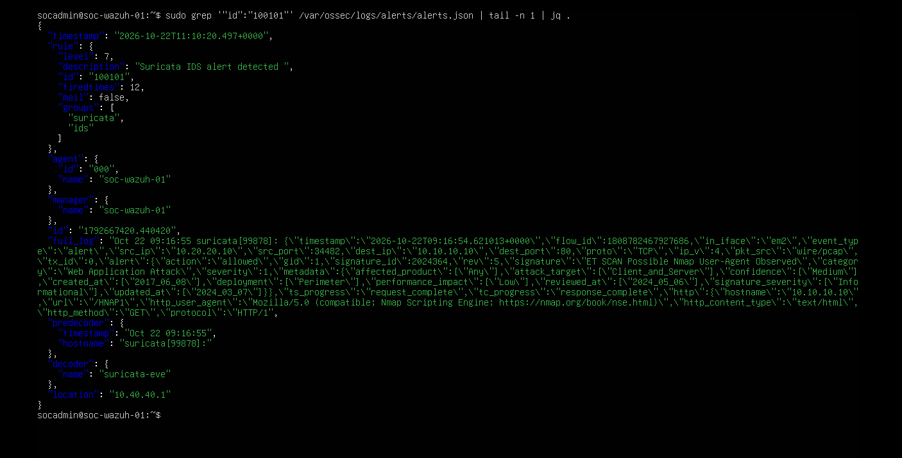
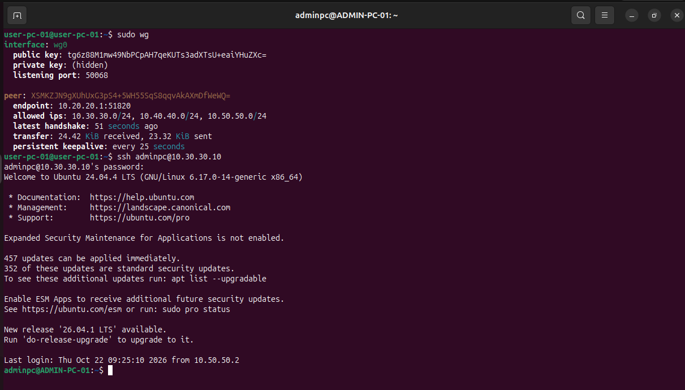
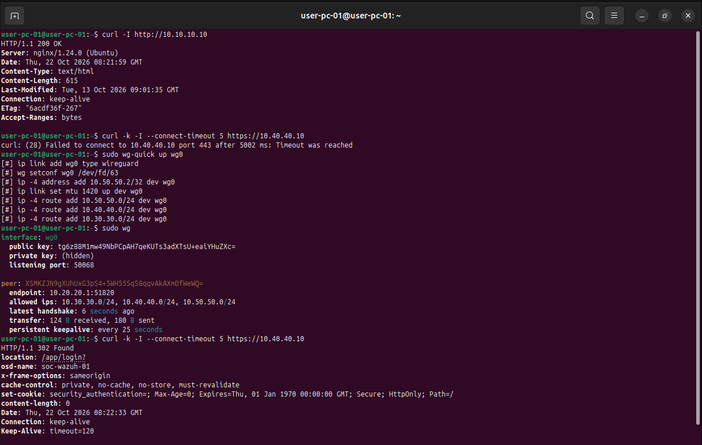
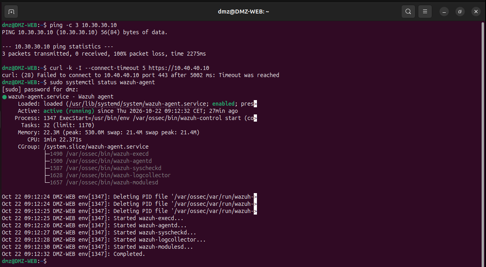
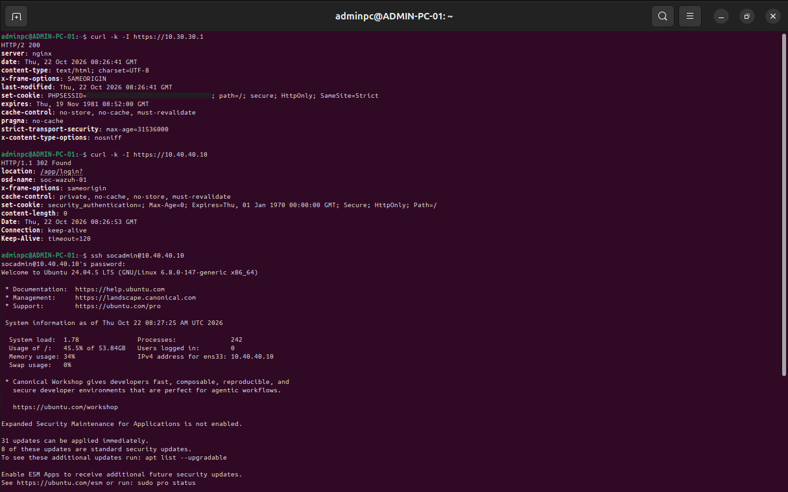
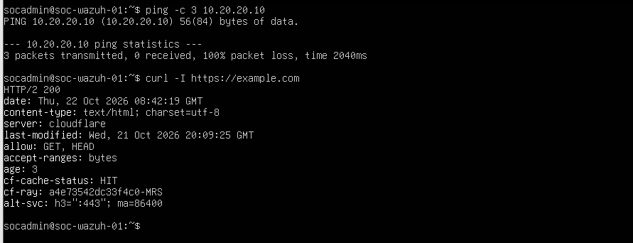

# Network Security & SOC Homelab

Hands-on cybersecurity homelab focused on network segmentation, firewall hardening, centralized monitoring, intrusion detection and secure remote administration.

## Project Overview

The objective of this project was to build a realistic segmented network environment using pfSense and several Linux virtual machines.

The lab implements:

- Network segmentation with pfSense
- DMZ, USERS, ADMIN and SERVERS security zones
- Wazuh SIEM/XDR monitoring
- Suricata IDS with ET Open rules
- Suricata alert forwarding to Wazuh
- WireGuard VPN
- Firewall hardening and least-privilege access
- Security testing with SSH and Nmap

## Network Architecture

| Zone | Network | Main Host |
|---|---|---|
| DMZ | `10.10.10.0/24` | DMZ-WEB `10.10.10.10` |
| USERS | `10.20.20.0/24` | USER-PC-01 `10.20.20.10` |
| ADMIN | `10.30.30.0/24` | ADMIN-PC-01 `10.30.30.10` |
| SERVERS | `10.40.40.0/24` | SOC-WAZUH-01 `10.40.40.10` |
| VPN | `10.50.50.0/24` | pfSense `10.50.50.1`, VPN client `10.50.50.2` |

pfSense acts as the central router and firewall between all network zones.

## Main Components

### pfSense

pfSense provides:

- Routing between the different network zones
- Stateful firewalling
- NAT
- Network segmentation
- WireGuard VPN
- Suricata IDS integration

Firewall policies follow a least-privilege approach.

### DMZ-WEB

`DMZ-WEB` is an Ubuntu web server located in the DMZ.

Main services:

- Nginx
- OpenSSH
- Wazuh agent

The DMZ is isolated from sensitive internal management networks.

### USER-PC-01

`USER-PC-01` represents a standard workstation.

It is used to:

- Access the DMZ web application
- Generate security test traffic
- Perform SSH authentication tests
- Run Nmap scans
- Establish the WireGuard VPN tunnel

### ADMIN-PC-01

`ADMIN-PC-01` is the dedicated administration workstation.

It is used for authorized access to:

- pfSense WebGUI
- Wazuh Dashboard
- SOC-WAZUH server through SSH

### SOC-WAZUH-01

`SOC-WAZUH-01` hosts the security monitoring platform.

It includes:

- Wazuh Manager
- Wazuh Indexer
- Wazuh Dashboard

## Wazuh SIEM

Wazuh agents were deployed on monitored Linux endpoints.

The SIEM centralizes security events including:

- SSH authentication failures
- Invalid user login attempts
- Endpoint security events
- Suricata IDS alerts

The monitored endpoints are:

- DMZ-WEB
- USER-PC-01

## SSH Attack Detection

Repeated invalid SSH authentication attempts were generated from `USER-PC-01` against `DMZ-WEB`.

Wazuh successfully detected:

- Failed password attempts
- Authentication attempts using a non-existent user
- Source IP address
- Target host
- MITRE ATT&CK related techniques

## Suricata IDS

Suricata was deployed on pfSense to inspect traffic from the USERS network.

ET Open signatures were enabled.

An Nmap scan generated a real IDS alert:

`ET SCAN Possible Nmap User-Agent Observed`

The alert identified:

- Source: `10.20.20.10`
- Destination: `10.10.10.10`
- Destination port: `80`
- Traffic classification: Web Application Attack

## Suricata and Wazuh Integration

Suricata events are forwarded from pfSense to Wazuh using syslog.

A custom Wazuh decoder was configured to identify Suricata EVE JSON events.

A local Wazuh rule was created:

`Rule ID: 100101`

The rule detects Suricata events where:

`event_type = alert`

Detection pipeline:

`Network Traffic → Suricata → Syslog → Wazuh Decoder → Rule 100101 → SIEM Alert`

## WireGuard VPN

WireGuard provides secure remote administration.

VPN network:

`10.50.50.0/24`

Example addressing:

- pfSense WireGuard interface: `10.50.50.1`
- VPN client: `10.50.50.2`

Without the VPN, the USERS network cannot directly access ADMIN or the Wazuh management interface.

After establishing the WireGuard tunnel, only explicitly authorized resources become reachable.

Example authorized access:

- VPN → ADMIN-PC SSH
- VPN → Wazuh HTTPS
- VPN → Wazuh agent communication

## Network Segmentation

The final firewall policy separates the environment into dedicated security zones.

### USERS

Allowed:

- HTTP access to the DMZ web server
- Wazuh agent communication
- DNS
- HTTP/HTTPS Internet access
- WireGuard tunnel establishment

Blocked:

- Direct ADMIN access
- Direct Wazuh management access
- Unauthorized internal network access

### DMZ

Allowed:

- Wazuh agent communication
- DNS
- NTP
- HTTP/HTTPS Internet access

Blocked:

- ADMIN network
- Wazuh Dashboard
- Internal management interfaces
- Unauthorized internal network access

### ADMIN

The ADMIN network is the dedicated management zone.

ADMIN-PC can access:

- pfSense WebGUI
- Wazuh Dashboard
- SOC-WAZUH through SSH

### SERVERS

The SERVERS network is isolated from other internal networks by default.

Allowed:

- DNS
- NTP
- HTTP/HTTPS Internet access
- Required management traffic

Blocked:

- Unauthorized traffic toward USERS, DMZ and other internal networks

## Firewall Hardening

The final firewall policy follows this general model:

1. Explicitly allow required internal communication
2. Block access to other internal networks
3. Allow only necessary Internet services
4. Restrict management access to ADMIN and WireGuard
5. Remove temporary and overly permissive rules

An `INTERNAL_NETWORKS` alias contains:

- `10.10.10.0/24`
- `10.20.20.0/24`
- `10.30.30.0/24`
- `10.40.40.0/24`
- `10.50.50.0/24`

This alias is used to simplify segmentation policies.

## Security Validation

Final validation included:

| Test | Result |
|---|---|
| USERS → DMZ HTTP | Allowed |
| USERS → ADMIN without VPN | Blocked |
| USERS → Wazuh Dashboard without VPN | Blocked |
| USERS → Wazuh Agent ports | Allowed |
| DMZ → ADMIN | Blocked |
| DMZ → Wazuh Dashboard | Blocked |
| DMZ → Wazuh Agent ports | Allowed |
| ADMIN → pfSense WebGUI | Allowed |
| ADMIN → Wazuh Dashboard | Allowed |
| ADMIN → Wazuh SSH | Allowed |
| SERVERS → USERS | Blocked |
| SERVERS → Internet HTTPS | Allowed |
| WireGuard → ADMIN-PC SSH | Allowed |
| WireGuard → Wazuh HTTPS | Allowed |
| SSH attack → Wazuh alert | Detected |
| Nmap traffic → Suricata alert | Detected |
| Suricata alert → Wazuh | Detected |

## Technologies

- VMware Workstation
- pfSense
- Ubuntu Server 24.04 LTS
- Ubuntu Desktop
- Wazuh
- Suricata
- ET Open Rules
- WireGuard
- Nginx
- Nmap
- SSH
- Syslog
- Git
- GitHub

## Skills Demonstrated

- Network architecture
- Network segmentation
- Firewall rule design
- Least-privilege access control
- DMZ implementation
- Routing and NAT
- Linux administration
- SIEM deployment
- IDS monitoring
- Log analysis
- Security event correlation
- VPN deployment
- Network troubleshooting
- Security testing
- Security hardening
- Technical documentation

## Project Limitations

Due to hardware resource limitations, Greenbone/OpenVAS was removed from the final version of the lab.

Suricata was implemented in IDS mode only.

IPS mode is considered a future improvement after proper signature tuning and false-positive evaluation.

## Future Improvements

Possible future extensions include:

- Suricata IPS mode
- Dedicated vulnerability scanner
- Additional attack and detection scenarios
- Infrastructure automation
- Centralized monitoring and metrics
- Dedicated remote VPN client outside the lab
- Windows Active Directory security lab as a separate project

## Disclaimer

This project was created in an isolated academic homelab for educational and defensive cybersecurity purposes.
